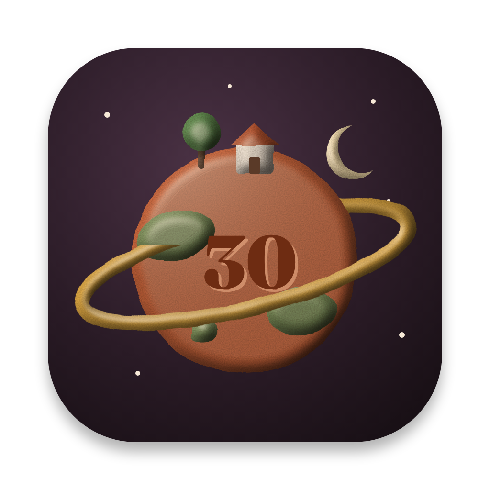

<p align="center">
  
</p>

<h1 align="center">Claybox</h1>

<p align="center">
  Play <em>The Neverhood</em> on your Mac, from your own disc, re-sculpted in HD.<br>
  A free tribute for the game’s 30th anniversary, by <a href="https://oxinstudio.com">Oxin Studio</a>.
</p>

<p align="center">
  <a href="https://oxinstudio.com/apps/claybox/"><strong>Download for Mac</strong></a>
  · Apple silicon (M1 or later) · macOS 14 or later
</p>

---

*The Neverhood* came out on 30 October 1996. Thirty years later it still has no equal, but getting it to run on a modern Mac means emulators, settings and the Terminal.

Claybox takes that away. Drop in your original CD, or an ISO made from it, and click **Play**. While you play, Claybox redraws the game in HD on your own Mac.

Claybox is built on [ScummVM](https://www.scummvm.org) and its Neverhood engine. Thank you to the ScummVM team: none of this would exist without their work.

## What it does

- **No Terminal.** Drop the disc or ISO on the window. Claybox checks that it is *The Neverhood* and copies the game files to your Mac once, so the disc isn’t needed again.
- **HD backgrounds.** All 259 scenes are upscaled 2× with [Real-ESRGAN](https://github.com/xinntao/Real-ESRGAN) on your Mac’s GPU. This takes about 40 minutes on a recent Mac, once, and you can play while it runs.
- **HD characters (optional).** Animated characters and objects, with their outlines upscaled too, so they sit softly on the HD scenes.
- **HD videos (optional).** All 551 cutscenes, upscaled frame by frame (about 3 GB).
- **Smooth picture.** Anything not yet in HD is smoothed for big screens. Can be turned off.
- **Private.** No account, no analytics, no network connections while you play or upscale.

## You need your own copy of the game

Claybox includes **nothing** from *The Neverhood*: no game files, no images, no sounds, no upscaled art. Everything HD is made on your Mac from your own disc.

It works with the original Windows release (1996) on CD, or an ISO image of that CD. Please don’t open issues asking where to get the game.

## Download

The signed and notarized app is on the Claybox page: **https://oxinstudio.com/apps/claybox/**

Requirements: a Mac with Apple silicon (M1 or later) and macOS 14 Sonoma or later. Intel Macs are not supported.

## How it works

Claybox has two parts:

1. **The engine** is ScummVM, built with only the Neverhood engine, plus [`claybox-hd.patch`](claybox-hd.patch). The patch adds an optional HD layer:
   - The game still runs at its original 640×480 with 8-bit colour, so game logic is untouched.
   - A parallel 1280×960 picture is composed from upscaled backgrounds, sprites and video frames when they exist, and from a smooth 2× of the original pixels when they don’t.
   - It follows the game’s palette fades, shadows and transparency, so HD art fades and darkens like the original.
   - Two headless modes export animation frames and video frames from the user’s own game files, for upscaling.
2. **The app** (`app/`, SwiftUI) is the launcher. It copies the game from the disc, runs the upscaler ([realesrgan-ncnn-vulkan](https://github.com/xinntao/Real-ESRGAN-ncnn-vulkan)) in the background, and starts the engine with the right settings.

Everything Claybox makes is stored in `~/Library/Application Support/Claybox/`.

The patch applies to ScummVM commit [`a822b48`](https://github.com/scummvm/scummvm/commit/a822b48a2ddd1bcdf742935f89ee94942e49539b).

## Building from source

You need Xcode (or the Command Line Tools) on an Apple silicon Mac, plus Homebrew for the development build.

**Development build** (uses Homebrew’s SDL2 and libpng; runs on your Mac only):

```bash
./build-claybox.sh            # clones ScummVM at the pinned commit, applies the patch, builds the engine
cd app && ./make-app.sh       # builds the app, downloads the upscaler once, assembles Claybox.app
open build/Claybox.app
```

**Release build** (self-contained, no Homebrew needed at runtime, macOS 14+):

```bash
./build-claybox.sh            # once, for the patched ScummVM source
./build-release-engine.sh     # builds SDL2, libpng and libjpeg-turbo statically, then the engine
cd app && ./make-app.sh --release
cd .. && ./sign-release.sh    # Developer ID signing, notarization and DMG
```

`sign-release.sh` signs with Oxin Studio’s identity by default. To sign with your own, set `CLAYBOX_SIGN_IDENTITY` and `CLAYBOX_NOTARY_PROFILE` (see the comments at the top of the script).

## Contributing

Bug reports and pull requests are welcome. When reporting a problem, please include your Mac model, macOS version and the engine log (in the app: **Help › Show Engine Log**).

If you work on ScummVM and any part of the HD layer is useful upstream, I’d be glad to help get it into shape there.

## Licence

Claybox is free software under the **GNU General Public License, version 3 or later**. See [LICENSE](LICENSE). It is based on ScummVM, which is also GPLv3+. Third-party components and their licences are listed in [THIRD-PARTY.md](THIRD-PARTY.md).

## Disclaimer

Claybox is a free fan tribute. It is not affiliated with or endorsed by the creators or rights holders of *The Neverhood*, or by the ScummVM team. *The Neverhood* and its characters are trademarks of their respective owners. ScummVM is a trademark of the ScummVM team.

---

Made by [Oxin Studio](https://oxinstudio.com) in Calgary, Canada. Small apps you buy once and own.
